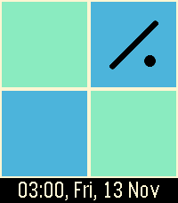
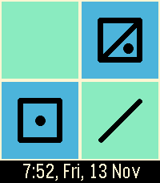
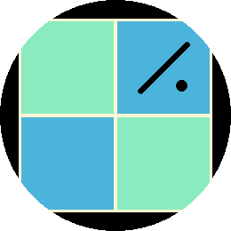
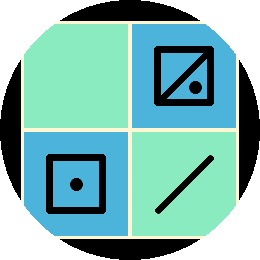

# Alien Time Keeper - Pebble Watchface

The Committee for Earthling Communication has designed these symbols
* 0 is nothing
* 1 is a dot
* 2 is a slash
* 3 is a slash and a dot (2 + 1)
* 4 is a square
* 5 is a square and a dot (4 + 1)
* 6 is a square and slash (4 + 2)
* 7 is a square, slash, and a dot (4 + 2 + 1)
* 8 is two squares (4 + 4)
* 9 is two squares and a dot (4 + 4 + 1)

The larger numbers are composed of smaller numbers, so Earthlings have fewer shapes to remember.

In case the Earthling's brain capacity is less than our models predict, time and date in an Earth language are included.

We got your little Arecibo message, by the way. So cute!

## Screenshots

### Emery

### Gabbro

## License

[![CC BY-SA 4.0][cc-by-sa-shield]][cc-by-sa]

This work is licensed under a
[Creative Commons Attribution-ShareAlike 4.0 International License][cc-by-sa].

[![CC BY-SA 4.0][cc-by-sa-image]][cc-by-sa]

[cc-by-sa]: http://creativecommons.org/licenses/by-sa/4.0/
[cc-by-sa-image]: https://licensebuttons.net/l/by-sa/4.0/88x31.png
[cc-by-sa-shield]: https://img.shields.io/badge/License-CC%20BY--SA%204.0-lightgrey.svg
