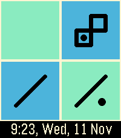
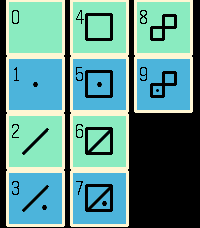
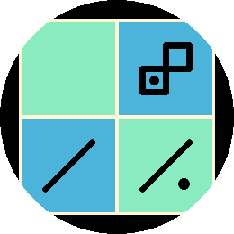
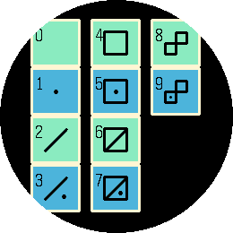

# Alien Time Keeper - Pebble Watchface

A digital watchface with alien-friendly digits and sometimes a friendly alien face too.

I designed new symbols for all the digits 0-9:
* 0 is nothing
* 1 is a dot
* 2 is a slash
* 3 is a slash and a dot (2 + 1)
* 4 is a square
* 5 is a square and a dot (4 + 1)
* 6 is a square and slash (4 + 2)
* 7 is a square, slash, and a dot (4 + 2 + 1)
* 8 is two squares (4 + 4)
* 9 is two squares and a dot (4 + 4 + 1)

The larger digits are made from smaller digits combined so earthlings have fewer shapes to remember.

For practicality (on square screens) the time and date are written across the bottom in an earth language.

Inspired by SETI communications like the Arecibo message.

## Screenshots

### Emery

### Gabbro

## License

[![CC BY-SA 4.0][cc-by-sa-shield]][cc-by-sa]

This work is licensed under a
[Creative Commons Attribution-ShareAlike 4.0 International License][cc-by-sa].

[![CC BY-SA 4.0][cc-by-sa-image]][cc-by-sa]

[cc-by-sa]: http://creativecommons.org/licenses/by-sa/4.0/
[cc-by-sa-image]: https://licensebuttons.net/l/by-sa/4.0/88x31.png
[cc-by-sa-shield]: https://img.shields.io/badge/License-CC%20BY--SA%204.0-lightgrey.svg
